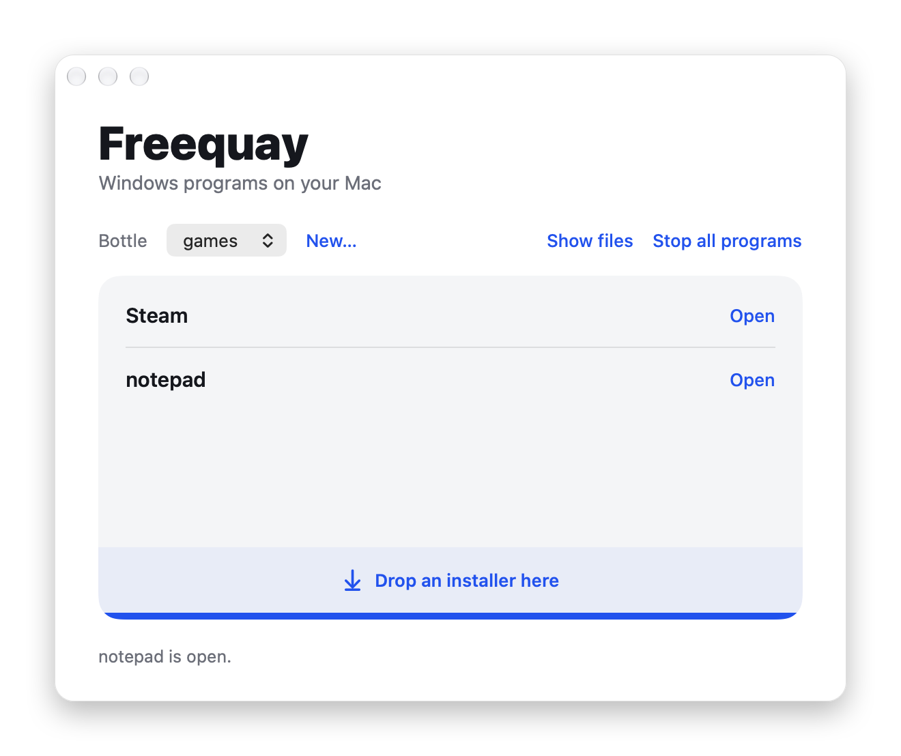

# Freequay

Freequay runs Windows games and programs on Apple Silicon Macs, for free: Wine built from the open source part of CodeWeavers' CrossOver 26.3.0, with a small app and settings per game from open sources. It is not affiliated with CodeWeavers or Apple.



## Download

You need an Apple Silicon Mac with macOS 14 or newer, Rosetta 2 and about 1.5 GB of free disk space; Steam takes another 1.5 GB, plus your games. Most Macs got Rosetta 2 with the first Intel app they opened; otherwise run `softwareupdate --install-rosetta` once in Terminal.

1. Download `freequay-0.2.2-macos.tar.xz` from the [latest release](https://github.com/loewenmaehne/freequay/releases/latest) and double-click it in Finder. That unpacks the folder `freequay-0.2.2`.
2. Open `Freequay.app` in that folder. The first time, macOS refuses it because the app is not notarized by Apple: open System Settings, Privacy & Security, click Open Anyway next to the note about Freequay and confirm. After that it opens normally.
3. Click Create a bottle, a Windows drive of its own (about a minute). Then install Steam with its button, or drop the installer of a Windows program on the window.

A bottle is not a sandbox. Wine shows your whole Mac to Windows programs as drive Z:, so they can read and change all your files, just as a Mac program can. Only start Windows programs you trust.

Leave the app in its folder: it finds the rest of Freequay next to itself. Drag it into the Dock to keep it at hand. Bottles and the settings from AppleGamingWiki live outside the folder, so a newer release can replace it.

## What runs

Tested on a MacBook Air M1 with 16 GB and macOS 27.0.1, not yet on an older macOS. Few games have been tried so far; reports are welcome as issues.

| Program | Result |
|---|---|
| Steam for Windows | installs, updates itself and signs in. The first start downloads about 575 MB in two updates and took 80 to 150 seconds in the tests; in one of three tests Steam then hung without a window, and Stop all programs and a new start helped. |
| Team Fortress 2 through Steam (Direct3D 9) | runs smoothly against bots, best in fullscreen |
| FINAL FANTASY XIV: Dawntrail Benchmark (Direct3D 11, .NET launcher) | runs through: 2679 points at 1920×1080 "High (Desktop)", 23 to 35 FPS in the foreground |
| Rockstar Games Launcher with Social Club | installs, updates itself, signs in and opens its main window |
| Black Myth: Wukong Benchmark Tool (Direct3D 12, D3DMetal) | hangs while loading, then Unreal's crash reporter comes up |

Games that play videos through Media Foundation may show them black, because GStreamer is not built yet. Apple's D3DMetal (Direct3D 11 and 12) is not included; you can add it from Apple's own download (see Build). Without it, Direct3D 12 runs on Wine's own d3d12 with vkd3d, tried so far only with small test programs.

## Using the app

- The list shows the programs of the chosen bottle: Steam, its games, every program whose installer put a shortcut into the Start menu or on the desktop, and every `.exe` started from the app except installers (setup, install or unins in the name).
- Open starts a program. Programs start one at a time: the row shows a spinner until the program's window appears, and Open on a program whose window is still open brings it forward.
- An installer or any other `.exe` dropped on the window or the Dock icon, or double-clicked in Finder, starts in the chosen bottle. A click on the strip at the foot of the list picks one instead.
- Every bottle has your whole Mac as drive Z:, so a Windows program can read and change all your files. Open only programs you trust.
- A right click takes a program off the list. Nothing is deleted or uninstalled.
- Show files opens the bottle's drive C: in Finder; Stop all programs ends every program of the bottle. Programs keep running when the app quits.
- If a program lies in Downloads, Documents or on the Desktop, macOS asks whether Freequay may access that folder. Allow it, or Wine cannot read the program.
- When it starts, the app lifts the download quarantine from its own folder. Without that, macOS would stop the unsigned `wine`.
- When it starts, the app also fetches the settings per game from AppleGamingWiki onto your Mac if they are missing or older than 30 days (about 3 MB, see Rules from open sources). Until then, games start without them.

Everything else, such as the graphics per program, is done in Terminal with `scripts/freequay`, the launcher the app calls as well.

## With Terminal

```bash
cd ~
curl -LO https://github.com/loewenmaehne/freequay/releases/download/v0.2.2/freequay-0.2.2-macos.tar.xz
tar -xf freequay-0.2.2-macos.tar.xz
cd freequay-0.2.2
scripts/freequay new games
```

curl sets no quarantine. After a browser download, macOS quarantines everything unpacked from it, by Finder or by `tar`, and stops the unsigned `wine` with a dialog until the app or this command lifts it: `xattr -dr com.apple.quarantine ~/freequay-0.2.2`.

The first `freequay new` downloads Wine Mono (82 MB) from WineHQ and, in the background, the settings per game from AppleGamingWiki (about 3 MB). `freequay fix`, which installs the runtime packages that rules ask for, needs python3 from the Command Line Tools (`xcode-select --install`), and many of those packages need `cabextract` (Homebrew); without them, Steam and games start without that setup.

Commands run from the release folder or the root of the repository.

```bash
scripts/freequay new games
scripts/freequay run games --backend dxmt "/path/to/Game.exe"
scripts/freequay run games "$HOME/Library/Application Support/freequay/Bottles/games/drive_c/Program Files (x86)/Steam/steam.exe"
scripts/freequay run games steam:440
scripts/freequay programs games
scripts/freequay programs games "/path/to/Game.exe"
scripts/freequay programs games "/path/to/Game.exe" -
scripts/freequay app games tf_win64.exe wined3d
scripts/freequay info games steam:440
scripts/freequay info "Grand Theft Auto IV"
scripts/freequay fix games --list
scripts/freequay applegamingwiki
```

Bottles live in `~/Library/Application Support/freequay/Bottles`. `run` starts a Windows program, a shortcut (`.lnk`) or a Steam game by its ID (`steam:440`, which Steam starts with `-applaunch`), and takes `--backend`, `--avx` (Rosetta reports AVX to the game), `--hud` (Metal performance HUD) and `--debug`. A program without a rule gets the bottle's default backend (`dxmt`, change it with `freequay set <bottle> backend <name>`) or the one from `--backend`. `dxmt` and `dxvk` have no Direct3D 12, so a program that imports `d3d12.dll` gets `d3dmetal` instead when it is installed, otherwise `wined3d`; without D3DMetal, programs that import `d3d11.dll` as well, as Unreal Engine games do, keep the default (details in `compat/README.md`).

`programs` lists what a bottle has, one name and `run` target per line, as the app shows it. With a program after the bottle it adds that to the list, and with `-` after the program it takes it off again: an added program is forgotten, a found one hidden. The bottle keeps both in `programs.txt`.

`freequay app <bottle> <program.exe|steam:ID> <backend>` sets the graphics for one program, `-` instead of the backend deletes it, and without a program the command lists the bottle's rules. `freequay rule` adds any directive, `freequay info` shows everything that applies to a program. New rules apply at the next program start, also while Steam is running. `freequay applegamingwiki` fetches the rules from AppleGamingWiki again.

Steam for Windows without the app: install it with `SteamSetup.exe /S` and start `steam.exe` with `run`. Before Steam starts, `run` catches up on the one-time setup the rules ask for (`freequay fix`).

## About

A quay is where ships come ashore; here Windows games land on your Mac. Quay is pronounced like "key".

Freequay is not affiliated with, endorsed by or supported by CodeWeavers or Apple. CrossOver is a trademark of CodeWeavers, Inc. CodeWeavers publish the sources this builds on and do most of the work on Wine for the Mac; if you want something that just works, with support, buy CrossOver.

### What is in it

- Wine 11.0 with all CodeWeavers patches from `crossover-sources-26.3.0.tar.gz`: msync, the D3DMetal hooks in winemac.drv, Rosetta tweaks and their fixes for single programs (Steam, the Rockstar Games Launcher, Epic, Ubisoft Connect, GTA IV and others). Built as x86_64 for Rosetta 2; 32-bit programs run through WoW64.
- FreeType, GnuTLS, nettle and gmp as x86_64 libraries from the same package. nettle 3.10 comes from the GNU release because the package lacks its `Makefile.in`.
- Graphics backends, chosen per program:
  - `dxmt`: DXMT 0.80 (Feifan He, MIT; versions after 0.80 are LGPL-2.1), Direct3D 10 and 11 on Metal.
  - `dxvk`: DXVK 1.10.3, CodeWeavers' Mac version from the same package (zlib), Direct3D 9 and 11 over Vulkan, with CodeWeavers' MoltenVK (Apache-2.0), which emulates geometry shaders.
  - `wined3d`: Wine's own Direct3D up to version 11; on the Mac CodeWeavers send Direct3D 10 and 11 through Vulkan. Direct3D 12 runs on Wine's d3d12 with vkd3d over MoltenVK.
  - `d3dmetal` and `d3dmetal3`: Apple's D3DMetal from the Game Porting Toolkit 4.0 beta 2 and 3.0, Direct3D 11 and 12. Only if you download it from Apple yourself; Apple's license applies.
- Wine Mono from WineHQ for .NET programs; every new bottle gets it. The release archive leaves it out, the first new bottle downloads it.
- Rules per program: the open counterpart of CrossOver's closed compatibility database, filled from umu-protonfixes, Proton, ProtonDB and DXVK. The rules from AppleGamingWiki are not in the archive; Freequay makes them on your Mac (see below).
- `Freequay.app` and `scripts/freequay`, the launcher for bottles that it calls.

Wine is built for macOS 11 and newer, MoltenVK for macOS 12 and the app for macOS 13. DXMT names macOS 14 as its minimum and recommends macOS 15; its release 0.80 is built for macOS 15. So every part is meant to run on macOS 14 and newer.

### What is not in it

Nothing from the CrossOver app itself: not its user interface, no CrossTie installers, no D3DMetal from CrossOver and not CodeWeavers' compatibility database. GStreamer is not built yet.

### Compared with CrossOver 26.3

| Part | CrossOver | Freequay |
|---|---|---|
| Wine with CodeWeavers' patches | yes | yes, the same source |
| D3DMetal (Apple) | included | from Apple's download |
| DXMT | yes | yes (release 0.80) |
| DXVK with CodeWeavers' MoltenVK | yes | built from the same package |
| wined3d | yes | yes |
| msync, 32-bit through WoW64 | yes | yes |
| .NET through Wine Mono | yes | yes, from WineHQ |
| Settings per game | closed compatibility database | open rules (patch 0005, `compat/`) from protonfixes, Proton, ProtonDB and DXVK, and from AppleGamingWiki, made on your Mac |
| One-click installers (CrossTie) | yes | no; `freequay fix` installs the runtime packages the rules ask for with winetricks |
| User interface | yes | one window that starts programs (`Freequay.app`) and the command `freequay` |
| GStreamer (videos in games) | yes | not built yet |

## Build

You need Xcode (MoltenVK is built with xcodebuild), Homebrew with `bison pkgconf mingw-w64 autoconf automake libtool m4 ninja glslang cabextract python` and about 4 GB of disk space for sources, build and result. All commands run from the root of the repository.

```bash
scripts/fetch-sources.sh      # CodeWeavers' sources and nettle, unpacked and patched in sources/
scripts/build-deps.sh         # gmp, nettle, GnuTLS, FreeType in deps/
scripts/build-moltenvk.sh     # CodeWeavers' MoltenVK in deps/lib; Wine's configure looks for it
scripts/build-wine.sh         # Wine in dist/wine
scripts/build-dxvk.sh         # DXVK in dist/backends/dxvk
scripts/install-dxmt.sh       # DXMT in dist/backends/dxmt
scripts/install-mono.sh       # Wine Mono for new bottles
scripts/compat/update.sh      # rules from the open sources, optional: compat/ has a recent copy
```

`build-wine.sh` builds Wine for macOS 11 and newer and leaves out `pipe2`. The macOS 27 SDK has that function and older macOS does not; Wine calls it without checking, so with it Wine would most likely not start on macOS 26 and older. Releases up to 0.2.0 were built with it.

D3DMetal: download "Evaluation environment for Windows games" from developer.apple.com, mount it and run `scripts/install-d3dmetal.sh "/Volumes/<volume>"`; pass `d3dmetal3` as the second argument for version 3.0. The script is in the release archive too; install D3DMetal again after replacing the folder with a newer release.

`scripts/build-app.sh` builds `Freequay.app` into the root of the repository with swiftc from Xcode or the Command Line Tools, and `scripts/compat/applegamingwiki`, which makes the rules from AppleGamingWiki. `scripts/package.sh 0.2.2` builds both as well and packs the build with the launcher, the app, the rules and the license texts into `out/freequay-0.2.2-macos.tar.xz`, the release archive.

## Patches

- `0001-ntdll-priority-dll-path`: `FREEQUAY_PRIORITY_DLLPATH` puts a backend's DLLs before Wine's builtin d3d11 and dxgi. CrossOver does the same from its closed compatibility database through `prepend_dll_path()`.
- `0002-win32u-zero-fill-monitor-device-name` and `dxvk-0002-dxgi-output-device-name-size`: the display name (`\\.\DISPLAY1`) arrives padded with zeros as on Windows. Before, DXMT, DXVK and D3DMetal passed on garbage behind it, and the FFXIV benchmark launcher cut the game's command line there.
- `0003-kernelbase-chromium-helpers-software-rendering`: `steamwebhelper.exe` and Rockstar's `SocialClubHelper.exe` get `--disable-gpu --disable-gpu-compositing --in-process-gpu`. Their Chromium otherwise draws from a separate GPU process, which winemac.drv does not show: the windows stayed black.
- `0004-registry-hkcu-software-shared-view`: `HKCU\Software` is the same key for 32 and 64 bit, as on Windows 7 and later, even when a `Wow6432Node` exists below it. Steam creates one; Wine then redirected 32-bit access there, `steam_api64.dll` did not find the running Steam, and Team Fortress 2 crashed at start.
- `0005-ntdll-compat-rules-per-program`: rules per program. Every program looks up rules for its path or Steam app ID in the files from `FREEQUAY_COMPAT_FILES` when it starts and gets its graphics backend, environment variables, DLL overrides and launch arguments from them; a broken launcher can be replaced by the game itself. ntdll sets environment variables before a child process starts, because Rosetta reads `ROSETTA_ADVERTISE_AVX` only at exec. That is how Steam runs with wined3d and a game started from it with DXVK. A program that imports `d3d12.dll` and has no backend rule gets D3DMetal or wined3d, because DXMT and DXVK have no Direct3D 12 and Wine's d3d12 does not work with their dxgi. Format and commands: `compat/README.md`.
- `0006-cfgmgr32-reject-unknown-notification-handles`: `CM_Unregister_Notification` rejects unknown handles as Windows does. Steam's `steamclient64.dll` unregisters a stale handle when a game quits; Wine wrote into freed memory and an error dialog came up after Team Fortress 2.
- `dxvk-0003-config-from-environment`: DXVK also reads options from `DXVK_CONFIG` (separated by `;`), as DXVK 2.x does, so rules can set DXVK options per game.
- `moltenvk-0002-spirv-cross-alias-overlapping-samplers`: DXVK declares a depth-compare twin of every Direct3D 9 sampler on the same binding. SPIRV-Cross turned the twin's texture into an alias of the argument buffer slot but forgot its sampler, so every Direct3D 9 pixel shader with a texture failed to compile in MoltenVK and DXVK drew nothing. The sampler now gets the same alias.
- `dxvk-0001` and `moltenvk-0001` keep DXVK and MoltenVK buildable with mingw-w64 14 and Xcode 27.

## Rules from open sources

`compat/` holds the rules tested here (`manual.txt`) and rules from four open sources; the rules from a fifth, AppleGamingWiki, are made on your Mac. `scripts/compat/update.sh` downloads the four sources again and regenerates their files; what a source does not give, or what only applies on Linux, goes to `notes.tsv` and shows up in `freequay info`.

| File | Source | License | Taken (2026-10-13) |
|---|---|---|---|
| `applegamingwiki.txt`, made on your Mac | AppleGamingWiki, reports on CrossOver on Apple Silicon | CC BY-NC-SA 3.0 | graphics backend for 80 games, where the reports recommend exactly one and none reports problems with it; `ROSETTA_ADVERTISE_AVX` and MoltenVK variables |
| `protonfixes.txt` | umu-protonfixes, fixes per game | BSD-2-Clause | 204 of 313 fixes: winetricks verbs, DLL overrides, variables, registry, launch arguments, replaced launchers |
| `proton.txt` | Valve's Proton, launcher script | BSD-3-Clause | 77 games: heap zeroing, FNA on Direct3D 11, OpenSSL mask, DLL overrides |
| `protondb.txt` | ProtonDB, open export of all reports | ODbL 1.0 | 94 games: launch arguments, DLL overrides and Large Address Aware that at least three reports and a quarter of the working reports since 2023 agree on |
| `dxvk.txt` | DXVK, current game profiles | zlib | 165 of 261 profiles with options DXVK 1.10.3 knows; only with `backend=dxvk` |

Most of these come from Linux, where Proton runs with DXVK and Vulkan drivers; only the AppleGamingWiki rules are about the Mac. CodeWeavers' compatibility pages sit behind bot protection and are not read automatically.

AppleGamingWiki's license allows no commercial use, so Freequay does not ship its rules. `freequay applegamingwiki` downloads the pages with a macOS compatibility table from applegamingwiki.com, about 3 MB at one request per second, and makes the rules in `~/Library/Application Support/freequay/compat`. The app does this when it opens, and `freequay new` and `freequay run` start it in the background whenever the rules are missing or older than 30 days; after a failed try, the next one waits an hour. Without network, programs start without these rules. The command runs `scripts/compat/applegamingwiki`, built from `applegamingwiki.swift`. Up to 0.2.1 a Python script made these rules and Freequay shipped them; on the same pages the Swift program writes what that script wrote, and on 2026-10-18 its rules matched the ones in 0.2.1.

The one-time setup (winetricks verbs, registry values, Windows version) is done by `freequay fix <bottle>` for all installed Steam games. All games share a bottle, so the DLL overrides a winetricks verb sets apply only to the programs of the game that asked for it.

## Tests

Graphics tests from 2026-10-13 on a MacBook Air M1 with macOS 27.0.1; the programs in `tests/` ran again with every backend on 2026-10-18 for 0.2.1 and 0.2.2:

| Test | Result |
|---|---|
| `cmd /c ver` | Microsoft Windows 10.0.19045, msync active |
| Direct3D 11, 64-bit, `dxmt` | feature level 11_0, adapter "Apple M1", triangle with shaders correct |
| Direct3D 11, 64-bit, `wined3d` over OpenGL | feature level 10_1, image correct |
| Direct3D 11, `wined3d` over Vulkan (CrossOver's default) | image correct with CodeWeavers' MoltenVK; crashed with the official MoltenVK |
| Direct3D 9, `wined3d` | image correct |
| Direct3D 9 with shaders and a texture (`tests/d3d9-shader`), 32- and 64-bit | correct with `wined3d`; with `dxvk` correct since patch moltenvk-0002, before that nothing was drawn |
| Direct3D 9 shadow map: a depth texture sampled with comparison (`tests/d3d9-shadow`), 32- and 64-bit | correct with `wined3d` and `dxvk` |
| Direct3D 9 and 11, `dxvk`, 32- and 64-bit | image correct with CodeWeavers' MoltenVK; the official one lacks geometry shaders |
| Direct3D 11, 32-bit, `dxmt` and `wined3d` | image correct (WoW64) |
| Direct3D 12, offscreen triangle with shaders (`tests/d3d12-draw`) | renders correctly with `d3dmetal`, `d3dmetal3` and with vkd3d over MoltenVK (Wine's own d3d12 with `wined3d`), with vkd3d also as a 32-bit program. `dxmt` and `dxvk` have no Direct3D 12; up to 0.2.0 `D3D12CreateDevice` failed with them, so a program without a rule did not start |
| Direct3D 12 without `--backend` or with `dxmt` or `dxvk` (`tests/d3d12-smoke`, `d3d12-draw`, `d3d12-draw32`), 0.2.1 | the 64-bit programs got `d3dmetal` with D3DMetal installed and `wined3d` without it, the 32-bit one `wined3d`; all correct, also when started by another program. The Unreal Engine 5 executable of the Wukong benchmark imports `d3d11.dll` and delay-loads `d3d12.dll`: it got `d3dmetal`, and kept `dxmt` without D3DMetal |
| Direct3D 11, `d3dmetal` (Apple 4.0 beta 2) | image correct; the adapter is called "AMD Compatibility Mode" |
| Direct3D 11, `d3dmetal3` (Apple 3.0) | image correct |
| Display name (`tests/devname`), all backends | padded with zeros with patches 0002 and dxvk-0002; garbage before with DXMT, DXVK and D3DMetal |

The programs under What runs need these backends, which their rules set: Steam and the Rockstar Games Launcher run with `wined3d`; with `dxmt` both abort at `SwapDeviceContextState`, the launcher with `dxvk` at `DXGID3D10CreateDevice`. Steam's window shows with patch 0003. Team Fortress 2 runs with `wined3d`, starts with patch 0004 and quits cleanly with patch 0006; with `dxvk` its image stayed black before patch moltenvk-0002 and was not tried again. The FFXIV benchmark ran with `dxmt`, its launcher on Wine Mono; a clean comparison of all backends is still open.

The release archives were tested like a new user would: downloaded with the quarantine a browser sets, unpacked into a new folder with a space in its path, with an empty home directory. With 0.1.0 all 29 graphics tests passed (Direct3D 9, 11 and 12, 32 and 64 bit, `dxmt`, `dxvk`, `wined3d`, vkd3d, and `d3dmetal` and `d3dmetal3` installed with the archive's `scripts/install-d3dmetal.sh`), and Steam installed, updated itself and showed its sign-in window. With 0.2.0 the app lifted the quarantine of its folder, created a bottle in 34 seconds with the Wine Mono download, opened Notepad from Finder, the Dock, a drop and its list within 2 to 4 seconds, installed Steam with its button and showed Steam's sign-in window about 80 seconds later. Programs started from the app stayed in the list after a restart, installers stayed out and removed entries stayed away; quick repeated clicks gave one program, and a click on an open program brought it forward. Not tested: Open Anyway for an app really downloaded with a browser. With 0.2.1, which changes the backend for Direct3D 12 and builds Wine without `pipe2`, the build folders were hidden during the test; the bottle took 31 seconds with Wine Mono copied from the build, and all 12 programs in `tests/` passed with `dxmt`, `dxvk`, `wined3d` and without `--backend`, then also with `d3dmetal` and `d3dmetal3` after `scripts/install-d3dmetal.sh` from the archive. The app and Steam were not tried again.

0.2.2 makes the rules from AppleGamingWiki on the Mac. Its archive was tested the same way, with the build folders out of the test's reach. The bottle took 31 seconds, the AppleGamingWiki rules arrived in the background meanwhile (1,884 pages in under a minute), and all 12 programs passed with every backend: 48 runs without D3DMetal, 72 with it. Started as one of six Steam games, a program got the same backend, variables and AVX setting as under 0.2.1, five of them through AppleGamingWiki rules; without those rules, the five got DXMT. Steam installed from the temp folder as the app's button does it and showed its sign-in window 146 seconds after its first start. The app lifted the quarantine of 2,004 files when it opened, made the AppleGamingWiki rules within 45 seconds and started Notepad from Finder in 3 seconds.

`tests/` has the small programs behind these tests; build them with mingw-w64 as their first comment says. `tests/rulecheck` shows what the rules changed for a program: its path, command line, environment variables and where `d3d11.dll` comes from.

## Folders

`downloads/` source packages, `sources/` unpacked and patched sources, `build/` build trees, `deps/` x86_64 libraries, `dist/` the finished build with its backends, `out/` release archives, `tools/` meson, `logs/` logs, `Freequay.app` the app built from `app/`, `scripts/compat/applegamingwiki` the program built from `applegamingwiki.swift` next to it. Only `app/`, `scripts/`, `patches/`, `compat/`, `tests/`, `licenses/` and the documents are versioned.

## License

- Scripts, app, tests and documents of this repository: MIT, see `LICENSE`.
- `patches/0*.patch` change Wine and are under Wine's license, LGPL-2.1-or-later. `patches/dxvk-*.patch` are under DXVK's zlib license, `patches/moltenvk-*.patch` under MoltenVK's Apache-2.0.
- The generated files in `compat/` keep the license of their source, named in each file's header: `protondb.txt` ODbL 1.0, `protonfixes.txt` BSD-2-Clause, `proton.txt` BSD-3-Clause, `dxvk.txt` zlib. Each row of `notes.tsv` names its source and keeps that source's license.
- The rules from AppleGamingWiki are not part of Freequay or its archive: `freequay applegamingwiki` makes them on your Mac, where they keep AppleGamingWiki's license, CC BY-NC-SA 3.0.
- Builds contain Wine, DXVK, MoltenVK, DXMT and other components under their own licenses. If you pass a build on, those licenses apply, including the LGPL's source requirements. D3DMetal is Apple's and under Apple's license.
- The release archive has the license texts of all its parts in `licenses/`; `licenses/README.md` lists them and where their source code is.
